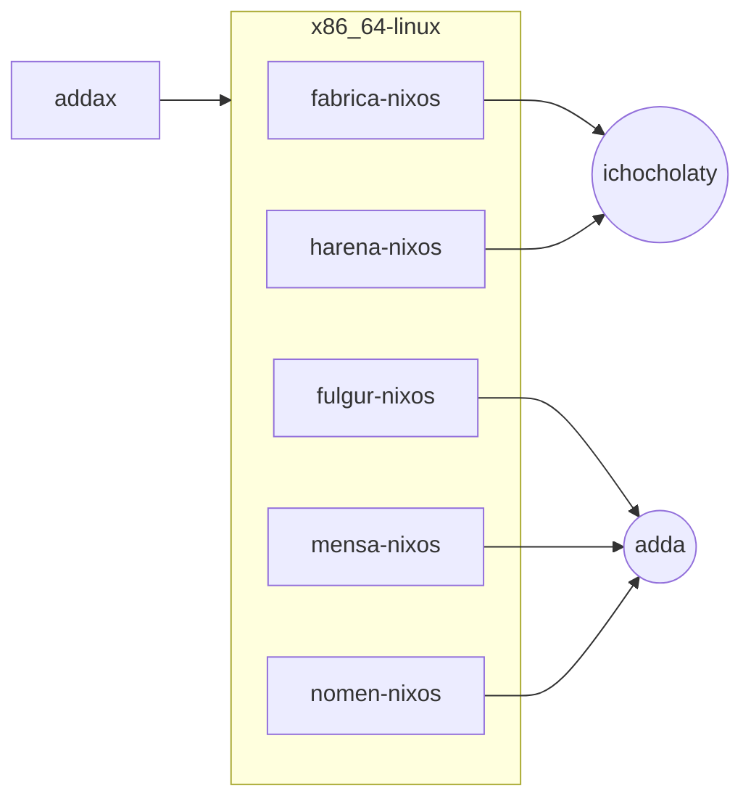
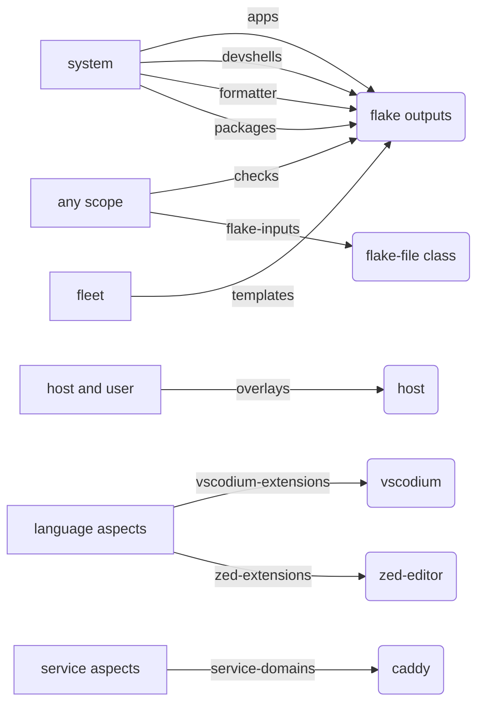
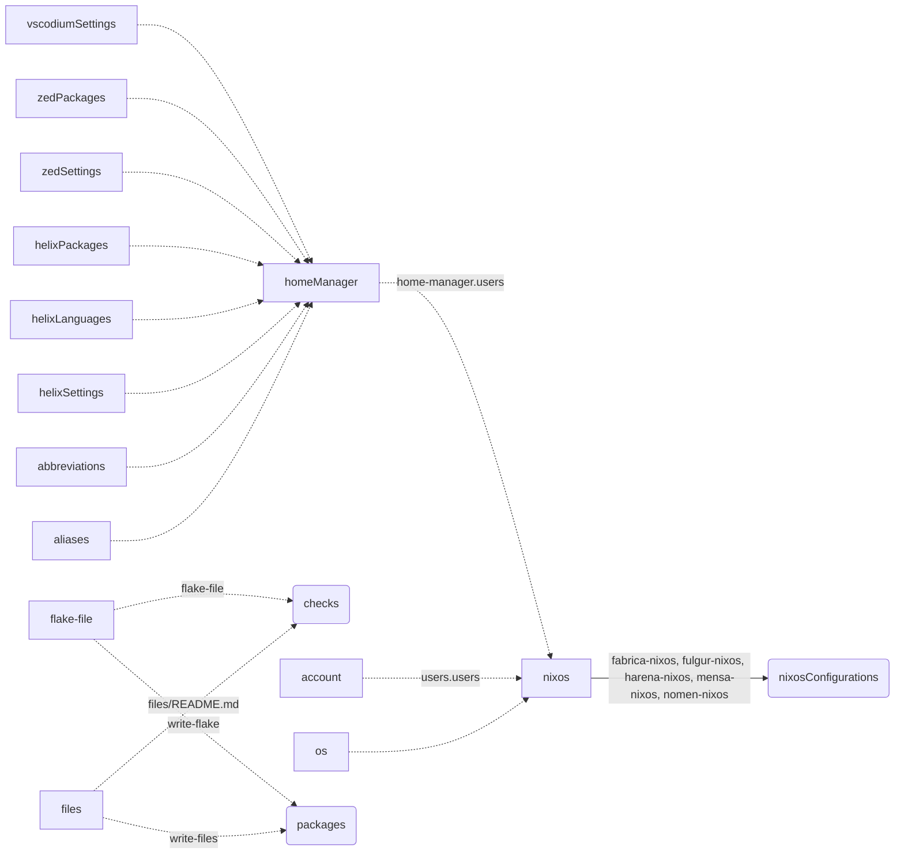

<!-- DO-NOT-EDIT.
This file was auto-generated using github:sini/files.
Use `nix run .#write-files` to regenerate it.
 -->

# Adda's NixOS configuration

<p align="center">
  <a href="https://nixos.org"></a>
  <a href="https://denful.dev"></a>
  <a href="https://flake.parts/"></a>
  <a href="https://github.com/nix-community/home-manager"> </a>
  <!-- <a href="https://github.com/mightyiam/dendritic"> </a> -->
</p>

My personal NixOS configuration, created during the uncountable number of hours over the years spent on shaping, and improving the tool configurations, and shuffling them around to better serve my needs.

It utilizes the [github:vic/ren](https://github.com/vic/ren) configuration library.

<!-- [Dentritic](https://vic.github.io/dendrix/Dendritic.html) pattern using -->

## adda

Adda's NixOS configurations in [Ren](https://github.com/vic/ren) (built on [Gen](https://github.com/sini/gen)).
Generated file: edit `modules/docs/`, then run `nix run .#write-files`.

## A tour

| Ren | in adda |
| --- | --- |
| `ren.kinds.<k>` | typed data: [`fleet`](modules/topology/fleet.nix#L8), [`host`](modules/topology/host.nix#L23), [`user`](modules/topology/user.nix#L38) |
| `ren.<k>.<name>` | an instance: [`ren.host.mensa-nixos`](modules/hosts/mensa-nixos/mensa-nixos.nix#L4), [`ren.user.adda`](modules/people/adda/adda.nix#L4), [`ren.fleet.addax`](modules/topology/fleet.nix#L30) |
| `below`, `spawns` | the scope tree: [`fleet → system, host`](modules/topology/fleet.nix#L9), [`host → user`](modules/topology/host.nix#L24), [`a host spawns a scope per user`](modules/topology/host.nix#L25) |
| `ren.aspects.<a>` | one feature: [`mensa-nixos`](modules/hosts/mensa-nixos/mensa-nixos.nix#L22), [`zram`](modules/swap/swap.nix#L13), [`watt`](modules/hardware/cpu-power.nix#L21) |
| `at` | where an aspect is on: [`at = ren.user.ichocholaty`](modules/people/ichocholaty.nix#L16), [`zram only where the host has a zram swap`](modules/swap/swap.nix#L14) |
| `includes` | add aspects below a scope: [`the work user includes workVM-user`](modules/people/ichocholaty.nix#L17) |
| `ren.classes.<c>` | a module system an aspect key feeds: [`nixos`](modules/platforms/nixos.nix#L11), [`os`](modules/platforms/nixos.nix#L22), [`account`](modules/platforms/nixos.nix#L28), [`homeManager`](modules/platforms/home-manager.nix#L24) |
| `into` | how a class builds: [`nixosConfigurations.<host>`](modules/platforms/nixos.nix#L14), [`files → write-files`](modules/flake/files/files.nix#L129) |
| `ren.channels.<c>` | data a feature emits for a receiver: [`overlays`](modules/features/base/overlays.nix#L4), [`service-domains`](modules/services/caddy.nix#L8), [`flake-inputs`](modules/flake/flake-file.nix#L8) |
| `fold`, `to` | how a channel merges, and who reads it: [`overlays fold into a list`](modules/features/base/overlays.nix#L5), [`received at the host`](modules/features/base/overlays.nix#L6) |
| `and`, `within`, `has`, `when` | predicates for `at`: [`when (s: s.host.cpuPower == n)`](modules/hardware/cpu-power.nix#L8), [`a user within a host`](modules/platforms/home-manager.nix#L7) |
| `ren.helpers` | pure functions shared by content: [`intoHm`](modules/platforms/home-manager.nix#L29) |

## Commands

```sh
nix build .#nixosConfigurations.fulgur-nixos.config.system.build.toplevel
nix run .#write-files     # regenerate this README (and the other generated files)
nix run .#write-flake     # regenerate flake.nix from the flake-inputs channel
nix run .#generate-files  # both of the above
nix flake check           # includes checks.x86_64-linux."files/README.md"
```

`just` runs recipes through Nushell. Trailing flags go to the underlying command.

| recipe | runs |
| --- | --- |
| `just` / `just switch` (`s`) | `nh os switch` for this host |
| `just build` (`bd`), `boot` (`b`), `test` (`t`) | `nh os build`, `boot`, `test` |
| `just host::switch <host>`, `host::build`, `host::boot` | the same for another host (`--hostname`; switch and boot use `--target-host`) |
| `just fmt` (`f`) | `nix fmt` (treefmt) |
| `just generate` (`g`) | `nix run .#generate-files` |
| `just check` (`c`) | `nix flake check` |
| `just flake::update`, `flake::show` | `nix flake update`, `nix flake show` |
| `just system-update` (`su`) | `generate`, then `flake::update`, then `switch` |
| `just tofu` (`tf`) | `nix run .#tofunix`, OpenTofu for the tailnet |
| `just sops-update` (`sou`) | `sops updatekeys --yes` |
| `just generations` (`ge`), `repl` (`r`) | `nh os info`, `nh os repl` |

## Fleet map

Generated from live Ren instances (`ren.fleet`, `ren.host`, `ren.user`).

Scope tree: `[host]` and `((user))`, grouped by system. Each host spawns one scope per user.



**Channels**: emitter to receiver, one edge per `ren.channels` name.



**Class forwarding**: solid edges carry live instance names, dashed edges are static.



## Hosts

Each host is a `ren.host.<hostname>` instance in `modules/hosts/<hostname>/<hostname>.nix`, with an aspect `at` it.

- [`fabrica-nixos`](modules/hosts/fabrica-nixos) (`x86_64-linux`): NixOS development work server

  "fabrica" is Latin for "workshop" or a "forge": the VM where the actual
  development work is done.

- [`fulgur-nixos`](modules/hosts/fulgur-nixos) (`x86_64-linux`): NixOS workstation for Work notebook Lenovo ThinkPad T14 Gen 4 Ryzen

  "fulgur" is Latin for "lightning": the fastest piece of hardware I own, and the one that does its work in short
  strikes — a notebook that is carried to wherever the work is, rebuilds the flake for the slower machines, and goes
  dark again.

- [`harena-nixos`](modules/hosts/harena-nixos) (`x86_64-linux`): NixOS benchmarking work server

  "harena" is Latin for "sand" ("sandbox" has no Latin equivalent) and the original spelling of "arena", where the
  "tools" fight each other for a better score: this VM runs the benchmarks.

- [`mensa-nixos`](modules/hosts/mensa-nixos) (`x86_64-linux`): NixOS homelab server

  "mensa" is Latin for "table", which is also what a "desktop" literally is: this is the one machine that stays on
  the desk instead of being carried around. It has since grown into the table everything is served from (files,
  documents, feeds, podcasts, notifications, DNS) and into the tailnet's exit node, so the other hosts eat here too.

- [`nomen-nixos`](modules/hosts/nomen-nixos) (`x86_64-linux`): NixOS workstation for Personal notebook MSI

  "nomen" is Latin for "name", and by extension a title: in this case the degree. This notebook went through the
  whole university with me and was the machine the Compurer Science degree was earned on, so it carries the name it
  helped me get.

Rebuild a host with `nh os switch --hostname <hostname>` (see `just host::switch`).

## How Adda uses Ren

**Kinds hold typed facts.** Aspects read the facts. They do not read each other.

- `host` ([topology/host.nix](modules/topology/host.nix)) has `workstation`, `signingKey`, `cpuPower`, `swap`, `ttyAutologin` and `vmAutologin`.
- `user` ([topology/user.nix](modules/topology/user.nix)) has `nick`, `realName`, `vcs`, `editors`, `aiRules` and `authorizedKeys`.
- `fleet` ([topology/fleet.nix](modules/topology/fleet.nix)) has `tailnet`, `upstreamDns`, `plainDns` and `ci`. One fleet, `addax`, owns the tailnet. No host reads another host's user for it.

**Invalid states do not exist.**

- `swap` is a record: `zram`, `swapspace` and `swapfile`. `zswap` is a field of `swapfile`. A host cannot have zswap without a swapfile.
- `cpuPower` is an enum: `auto-cpufreq` or `watt`. A host picks one. No assertion checks for two handlers.
- `ttyAutologin` and `vmAutologin` hold a user, not a string. A name that is not a user does not evaluate.

**Two users, two identities.** `adda` is the personal user. `ichocholaty` is the work identity on `fabrica-nixos` and `harena-nixos`. It is its own `ren.user`, with its own aspect at it. The `workstation` aspect is on only where `ren.user.adda` is on a host with `workstation = true`.

**Classes route user content.**

- `os` writes NixOS config from a user aspect into the host.
- `account` writes `users.users.<login>`.
- `homeManager` writes the home of a user inside the host.
- `aliases` and `abbreviations` write shell aliases and abbreviations (fish, nushell, zsh) into home-manager.
- `helixSettings`, `helixLanguages`, `helixPackages`, `zedSettings`, `zedPackages` and `vscodiumSettings` let a language aspect add editor settings. They merge in one home-manager option each ([editors/quirks.nix](modules/editors/quirks.nix)).

**Channels move data between scopes.**

- `zed-extensions` and `vscodium-extensions`: a user emits extension ids. The editor aspect reads the whole set.
- `overlays`: a host or user emits nixpkgs overlays. The host applies them once.
- `service-domains`: a service emits a function of the realized NixOS config. Caddy calls each function and builds the reverse proxy from the results.
- `packages`: a system emits flake packages. Content reads them back with the `selfPackages` helper ([helpers.nix](modules/helpers.nix)).
- `flake-inputs`: any scope names flake inputs. The `flake-file` class writes them to `flake.nix`.

## Directory structure

import-tree loads every `.nix` file under `modules/`. Paths with `/_` are skipped.
Dir names are for humans only. Ren does not read them.

| dir | purpose |
| --- | --- |
| `modules/ai/` | Claude, omp, ollama, herdr and voxtype, with the shared AI rules. |
| `modules/audio/` | PipeWire audio stack. |
| `modules/community/` | Placeholder for modules shared with others; empty for now. |
| `modules/console/` | Shells, terminal tools, multiplexers and version control. |
| `modules/desktop/` | Desktop environments, browsers, games, flatpak and nix-ld. |
| `modules/development/` | Android tooling and general development packages. |
| `modules/docs/` | This README: generator, fleet graphs and vocabulary. |
| `modules/editors/` | Helix, Zed, VSCodium, NvChad, JetBrains, and the editor contribution classes and channels. |
| `modules/features/` | Defaults every host or user gets: base, accounts, overlays, packages, networking, state version. |
| `modules/filesystems/` | Extra filesystem support (NTFS). |
| `modules/flake/` | Flake outputs: channels, files class, flake-file, devshell, formatter, tests, tofunix, templates. |
| `modules/hardware/` | Hardware aspects: bare metal and CPU power handlers. |
| `modules/hosts/` | One directory per NixOS host: the `ren.host` instance, its aspect and hardware. |
| `modules/kernel/` | The xanmod kernel. |
| `modules/languages/` | Language toolchains. Each also contributes editor settings and extensions. |
| `modules/media/` | Books, music, podcasts and other media apps. |
| `modules/misc/` | Small desktop services: fonts, KDE Connect, Syncthing, xremap, autologin. |
| `modules/network/` | NetworkManager, Portmaster and the Tailscale client roles. |
| `modules/people/` | The users: `adda` (personal) and `ichocholaty` (work). |
| `modules/platforms/` | The classes that build systems: nixos, os, account, homeManager, aliases, abbreviations. |
| `modules/security/` | GPG, sops, ClamAV. |
| `modules/services/` | Homelab services and the caddy reverse proxy. |
| `modules/swap/` | Swap aspects driven by the host `swap` record. |
| `modules/topology/` | The kinds: fleet, system, host, user. |
| `modules/virtualisation/` | VM guests, Proxmox, Waydroid and bootable VM images. |
| `modules/work-vm/` | The headless work VM profile. |
