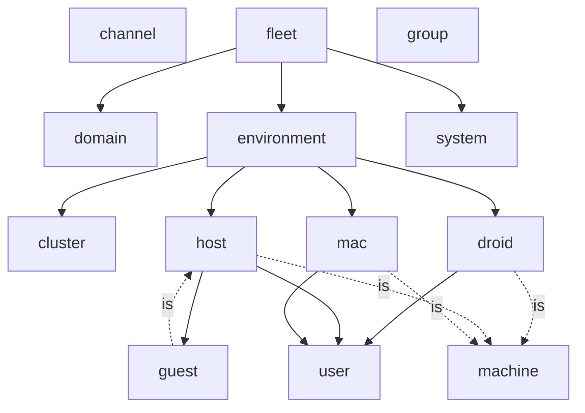
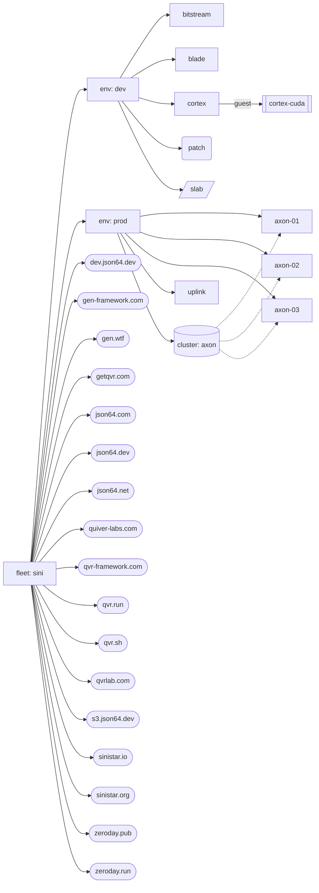
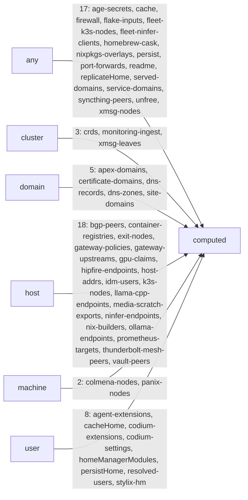
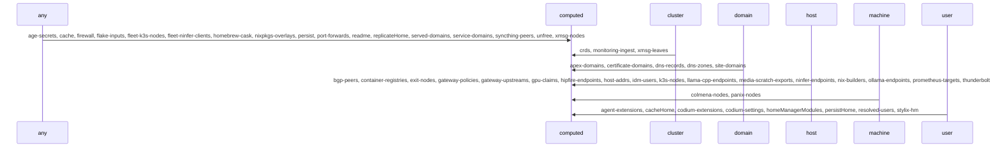

<div align="center">
  
</div>

<br />

<br>

# sini/nix-config

<br>
<div align="center">
    <a href="https://github.com/sini/nix-config/stargazers">
        
    </a>
    <a href="https://github.com/sini/nix-config">
        
    </a>
    <a href="https://nixos.org">
        
    </a>
    <a href="https://github.com/sini/nix-config/blob/main/LICENSE">
        
    </a>
</div>
<br>

sini's [NixOS](https://nix.dev) homelab and workstation configuration repository.

> [!NOTE]
> If you have any questions or suggestions, feel free to contact me via e-mail `jason <at> json64 <dot> dev`.

## Hosts

| Name                                               | Description                                                                                             |      Type   |        Arch    |
| :------------------------------------------------- | :------------------------------------------------------------------------------------------------------ | :---------: | :------------: |
| [uplink](modules/hosts/uplink/uplink.nix)          | Ryzen 5950X (16/32) - 128GB - 10gbe - Intel Arc A310 - AV1 Transcoding / Router / k8s control           |    Server   |  x86_64-linux  |
| [axon-01](modules/hosts/axon-01/axon-01.nix)       | MINISFORUM Venus UM790 Pro - Ryzen 9 7940HS (8/16) - 64GB - 2.5gbe - Radeon 780M - k8s node             |    Server   |  x86_64-linux  |
| [axon-02](modules/hosts/axon-02/axon-02.nix)       | MINISFORUM Venus UM790 Pro - Ryzen 9 7940HS (8/16) - 64GB - 2.5gbe - Radeon 780M - k8s node             |    Server   |  x86_64-linux  |
| [axon-03](modules/hosts/axon-03/axon-03.nix)       | MINISFORUM Venus UM790 Pro - Ryzen 9 7940HS (8/16) - 64GB - 2.5gbe - Radeon 780M - k8s node             |    Server   |  x86_64-linux  |
| [bitstream](modules/hosts/bitstream/bitstream.nix) | GMKtec M6 - Ryzen 5 6600H (8/16) - 64GB - 2.5gbe - Radeon 660M - k8s node                               |    Server   |  x86_64-linux  |
| [cortex](modules/hosts/cortex/cortex.nix)          | Ryzen 9950X3D (16/32) - 128GB - 10gbe - 7900XTX + 3090TI - Hybrid ML Server/Workstation/VFIO Gaming Rig | Workstation |  x86_64-linux  |
| [blade](modules/hosts/blade/blade.nix)             | Razer Blade 16 (2023) - NixOS - 32GB ram - RTX 4090 (mobile)                                            |    Laptop   |  x86_64-linux  |
| [patch](modules/hosts/patch/patch.nix)             | M1 Macbook Air - 16gb / 1tb - macOS Sequoia 15.2                                                        |    Laptop   | aarch64-darwin |


## Architecture

This repository is a [Ren](https://github.com/vic/ren) fleet.
A fleet is a tree of typed instances (kinds).
Aspects attach config to the instances they match.
Classes turn that config into flake outputs.

### Kinds

Kinds live in `modules/topology`, one file per kind.

| Kind | Purpose |
| :--- | :--- |
| `fleet` | Root of the tree. One instance: `sini`. |
| `system` | Per-system outputs (x86_64-linux, aarch64-linux, aarch64-darwin). |
| `channel` | Data: nixpkgs, home-manager and nix-darwin triple, plus the system builders. |
| `environment` | Domain, networks, certs, delegation, services (prod, dev). |
| `group` | Membership labels and members. Used for access control. |
| `machine` | Abstract: system, channel, environment, owner, facts, exporters. |
| `host` | A NixOS machine. Is a `machine`. |
| `guest` | A microvm guest. Is a `host`. |
| `mac` | A nix-darwin machine. Is a `machine`. |
| `droid` | A nix-on-droid machine. Is a `machine`. |
| `user` | Identity (SSH, GPG), uid, groups. |
| `cluster` | A k8s cluster: role, version, hosts, networks. |
| `domain` | A DNS zone with its DNS, TLS, web and mail data. |

### Scope Tree

Each instance sits under a parent kind (`below`). Aspects and classes match by kind.

```
fleet
 +-> environment
 |   +-> host / mac / droid
 |   |   +-> user
 |   |   +-> guest (host field `guests`)
 |   +-> cluster
 +-> domain
 +-> system
```

Users reach a machine through `ren.helpers.usersOf` (group closure plus environment and host gates).
Macs and droids list their users in a `users` field.

### How a host gets its config

1. The host is an instance in `modules/hosts/<h>/<h>.nix`, for example `ren.host.uplink`.
   It sets `system`, `channel`, `environment`, `system-owner`, `system-access-groups`, networking and per-aspect settings.
2. A same-named aspect, `ren.aspects.<h>`, has `at = ren.host.<h>`.
   Its `includes` list pulls in roles and features.
3. Roles (`modules/roles`) are aspects that only have `includes`. The `default` role applies to every machine.
4. Features (`modules/features`) emit class keys: `nixos`, `darwin`, `homeManager`, and others.
5. Channels (`modules/channels`) carry data between instances. Aspects emit into them. Receivers read them.
6. The `nixos` class (`modules/platforms/nixos.nix`) collects all modules for a metal host.
   It builds `nixosConfigurations.<h>` with the host's `channel.nixosSystem`.
   It also emits `colmena-nodes.<h>` for the colmena hive.

### Classes

Classes live in `modules/platforms`. A class says where its modules go.

| Class | Output |
| :--- | :--- |
| `nixos` | `nixosConfigurations` for metal hosts. Microvm guests forward into `microvm.vms` on the parent host. |
| `darwin` | `darwinConfigurations` for macs. |
| `droid` | `nixOnDroidConfigurations` for droids. |
| `os` | Shared config forwarded into `nixos` or `darwin`. |
| `homeManager`, `homeLinux`, `homeDarwin` | home-manager users on each machine. The latter two select by system suffix. |
| `account` | `users.users` entries. |
| `k8s-manifests` | nixidy environments per cluster. |
| `terranix` | Terranix modules (DNS, GitHub, UniFi). |
| `panix` | Panix node modules. |
| `devshell` | `devShells.<system>.default`. |
| `packages`, `apps`, `checks`, `legacyPackages`, `chartsDerivations`, `imagesDerivations` | Per-system outputs. |
| `treefmt` | Formatter config. |
| `files` | Generated repo files: README, LICENSE, `.gitignore`, `.sops.yaml`. |

### Channels

Channels live in `modules/channels`, grouped by family in files named `<family>-am.nix` and `<family>-nz.nix`.
Families: agents, darwin, deploy, discovery, dns, edge, editors, flake, k8s, mesh, monitoring, overlays, secrets, storage, sync, unfree.
Examples: `persist`, `firewall`, `age-secrets`, `nixpkgs-overlays`, `host-addrs`, `colmena-nodes`, `readme`.

### Helpers

Helpers live in `modules/helpers`, one file per helper, as `ren.helpers.<name>`.
Examples: `usersOf`, `groupClosure`, `setting`, `ipv4Of`, `ipv6Of`, `deployment`, `domainFor`, `clusterOf`, `sopsAgeRecipient`, `repo`.

### Settings

A feature setting is one typed field on the kind that reads it, named like the aspect.
An instance sets it in its own file, for example `svc-bgp.localAsn` on `ren.host.uplink`.
`ren.helpers.setting` reads the nearest value, host first, then environment.

### Directory Layout

```
modules/
+-- topology/       Kind definitions (fleet, system, channel, environment, group, machine, host, guest, mac, droid, user, cluster, domain)
+-- platforms/      Class definitions (nixos, darwin, droid, homeManager, k8s, terranix, panix, files, ...)
+-- channels/       Data channels between aspects and receivers
+-- helpers/        Shared functions: ren.helpers.<name>
+-- features/       Aspects, one directory per capability (boot, disk, hardware, desktop, apps, dev, services, k8s, ...)
+-- roles/          Named bundles of features (default, server, workstation, dev, gaming, ...)
+-- hosts/<h>/      One host, mac, droid or guest instance plus its aspect
+-- people/         User instances
+-- environments/   Environment instances (prod, dev) and groups/
+-- clusters/       Cluster instances (axon)
+-- domains/        Domain instances, one file per zone
+-- flake/          Flake wiring: inputs, systems, pkgs, treefmt, devshell, terranix/, meta
+-- docs/           README fragments and generated files
```


# Fleet Topology

Generated from live Ren data (`ren.kinds`, `ren.<kind>`, `ren.classes`, `ren.channels`): the kind tree, how classes forward modules and how channels move data.

## Scope Topology

Kind tree: solid edges are `below` (parent scope to child scope), dotted edges are `is` (inheritance).



Instances: fleet, environments, machines (`[host]` `(mac)` `[/droid/]` `[[guest]]`), clusters and domains.



## Policy Resolution

Class resolution: an aspect key naming a class sends its modules to the class, which collects them at its `at` kind.

```mermaid
flowchart LR
class_account("account")
class_apps("apps")
class_chartsDerivations("chartsDerivations")
class_checks("checks")
class_darwin("darwin")
class_devshell("devshell")
class_droid("droid")
class_files("files")
class_flake("flake")
class_flake_file("flake-file")
class_homeDarwin("homeDarwin")
class_homeLinux("homeLinux")
class_homeManager("homeManager")
class_imagesDerivations("imagesDerivations")
class_k8s_manifests("k8s-manifests")
class_legacyPackages("legacyPackages")
class_nixos("nixos")
class_os("os")
class_packages("packages")
class_panix("panix")
class_pre_commit("pre-commit")
class_searxngCheck("searxngCheck")
class_terranix("terranix")
class_treefmt("treefmt")
class_unifi_terranix("unifi-terranix")
class_xmsgCheck("xmsgCheck")
n_any["any"]
n_system["system"]
n_droid["droid"]
n_fleet["fleet"]
n_cluster["cluster"]
  class_account --> n_any
  class_apps --> n_system
  class_chartsDerivations --> n_system
  class_checks --> n_system
  class_darwin --> n_any
  class_devshell --> n_system
  class_droid --> n_droid
  class_files --> n_fleet
  class_flake --> n_fleet
  class_flake_file --> n_fleet
  class_homeDarwin --> n_any
  class_homeLinux --> n_any
  class_homeManager --> n_any
  class_imagesDerivations --> n_system
  class_k8s_manifests --> n_cluster
  class_legacyPackages --> n_system
  class_nixos --> n_any
  class_os --> n_any
  class_packages --> n_system
  class_panix --> n_any
  class_pre_commit --> n_system
  class_searxngCheck --> n_system
  class_terranix --> n_any
  class_treefmt --> n_system
  class_unifi_terranix --> n_any
  class_xmsgCheck --> n_system
```



## Pipe Flow

Channels: aspects emit at the `at` kind; the receiver `to` folds the pool. One edge per kind pair, labelled with its channels.



## Pipe Sequence

Order of emission by kind pair (channel names are Ren-global; each edge lists its channels).



## Fleet Summary

# Fleet Summary

## Topology

- **2** environments, **10** machines (7 hosts, 1 macs, 1 droids, 1 guests), **7** users, **1** clusters, **17** domains
- Scope chain: fleet, then environment | domain | system, then machine, then user | guest
- Kinds: **13**, classes: **26**, channels: **53**, aspects: **520**

| Kind | Below | Is | Instances |
| --- | --- | --- | --- |
| `channel` |  |  | 5 |
| `cluster` |  |  | 1 |
| `domain` |  |  | 17 |
| `droid` | user | machine | 1 |
| `environment` | host, mac, droid, cluster |  | 2 |
| `fleet` | environment, domain, system |  | 1 |
| `group` |  |  | 36 |
| `guest` |  | host | 1 |
| `host` | user, guest | machine | 7 |
| `mac` | user | machine | 1 |
| `machine` |  |  | 0 |
| `system` |  |  | 3 |
| `user` |  |  | 20 |

## Environments

| Environment | Hosts | Host Count | Users |
| --- | --- | --- | --- |
| dev | bitstream, blade, cortex, patch, slab, cortex-cuda | 6 | 7 |
| prod | axon-01, axon-02, axon-03, uplink | 4 | 5 |

## Aspects by Host

| Host | Aspect Count | Aspects |
| --- | --- | --- |
| axon-01 | 14 | default, boot-network-initrd, disk-zfs-disk-single, disk-xfs-disk-longhorn, server, unlock, nix-builder, svc-bgp-spoke, svc-bgp-cilium-bgp, svc-k3s, svc-storage-media-scratch, hardware-cpu-amd, hardware-gpu-amd, svc-networking-thunderbolt-mesh-of |
| axon-02 | 13 | default, boot-network-initrd, disk-zfs-disk-single, disk-xfs-disk-longhorn, server, unlock, nix-builder, svc-bgp-spoke, svc-bgp-cilium-bgp, svc-k3s, hardware-cpu-amd, hardware-gpu-amd, svc-networking-thunderbolt-mesh-of |
| axon-03 | 13 | default, boot-network-initrd, disk-zfs-disk-single, disk-xfs-disk-longhorn, server, unlock, nix-builder, svc-bgp-spoke, svc-bgp-cilium-bgp, svc-k3s, hardware-cpu-amd, hardware-gpu-amd, svc-networking-thunderbolt-mesh-of |
| bitstream | 13 | default, server, dev, nix-builder, disk-zfs-disk-single, boot-network-initrd, hardware-cpu-amd, hardware-gpu-amd, dev-mux-herdr-pair, svc-matrix-xmsg, svc-ai-genie-expert, svc-ai-genie-xmsg, svc-ai-genie-tier1 |
| blade | 20 | default, workstation, gaming, dev, dev-gui, messaging, media, hardware-cpu-intel, hardware-gpu-intel, hardware-gpu-nvidia, hardware-gpu-nvidia-prime, hardware-laptop, hardware-razer, hardware-performance, desktop-uwsm, disk-zfs-disk-single, boot-wireless-initrd, network-manager, network-tailscale, dev-mux-herdr-pair |
| cortex | 25 | default, workstation, gaming, dev, dev-gui, media, messaging, nix-builder, hardware-cpu-amd, hardware-gpu-amd, hardware-gpu-nvidia-vfio, svc-monitoring-prometheus-exporter, svc-alloy, hardware-performance, hardware-vr-amd, hardware-bigscreen-beyond, desktop-uwsm, disk-zfs-disk-single, boot-network-initrd, virtualization-microvm-host, virtualization-windows-vfio, virtualization-podman, svc-storage-media-data-share, app-media-easyeffects, dev-mux-herdr-pair |
| uplink | 31 | default, boot-network-initrd, disk-zfs-disk-single, server, unlock, nix-builder, svc-monitoring-alertmanager, svc-bgp-hub, svc-networking-headscale, svc-security-acme, dns-state-passphrase-age-secrets, unifi-state-passphrase-age-secrets, github-state-passphrase-age-secrets, svc-networking-nginx, svc-security-kanidm, svc-networking-gateway-upstream, svc-media-jellyfin, svc-web-homepage, svc-security-oauth2-proxy, svc-ai-ollama, svc-ai-open-webui, svc-nix-attic, network-tailscale, network-tailscale-exit-node, network-syncthing-hub, svc-web-den-docs-mirror, svc-web-gen-status, svc-web-container-registry, virtualization-podman, hardware-cpu-amd, hardware-gpu-intel |
| patch | 4 | default, dev, darwin-workstation, nix-linux-builder |
| slab | 3 | dev, app-shell-zsh, nix-on-droid-base-droid |
| cortex-cuda | 6 | default, inference, svc-ai-hyperqwen, hardware-gpu-nvidia, svc-monitoring-prometheus-exporter, svc-alloy |

## Pipes

| Pipe | Emitted at | Received by |
| --- | --- | --- |
| `age-secrets` | any | computed |
| `agent-extensions` | user | computed |
| `apex-domains` | domain | computed |
| `bgp-peers` | host | computed |
| `cache` | any | computed |
| `cacheHome` | user | computed |
| `certificate-domains` | domain | computed |
| `codium-extensions` | user | computed |
| `codium-settings` | user | computed |
| `colmena-nodes` | machine | computed |
| `container-registries` | host | computed |
| `crds` | cluster | computed |
| `dns-records` | domain | computed |
| `dns-zones` | domain | computed |
| `exit-nodes` | host | computed |
| `firewall` | any | computed |
| `flake-inputs` | any | computed |
| `fleet-k3s-nodes` | any | computed |
| `fleet-ninfer-clients` | any | computed |
| `gateway-policies` | host | computed |
| `gateway-upstreams` | host | computed |
| `gpu-claims` | host | computed |
| `hipfire-endpoints` | host | computed |
| `homeManagerModules` | user | computed |
| `homebrew-cask` | any | computed |
| `host-addrs` | host | computed |
| `idm-users` | host | computed |
| `k3s-nodes` | host | computed |
| `llama-cpp-endpoints` | host | computed |
| `media-scratch-exports` | host | computed |
| `monitoring-ingest` | cluster | computed |
| `ninfer-endpoints` | host | computed |
| `nix-builders` | host | computed |
| `nixpkgs-overlays` | any | computed |
| `ollama-endpoints` | host | computed |
| `panix-nodes` | machine | computed |
| `persist` | any | computed |
| `persistHome` | user | computed |
| `port-forwards` | any | computed |
| `prometheus-targets` | host | computed |
| `readme` | any | computed |
| `replicateHome` | any | computed |
| `resolved-users` | user | computed |
| `served-domains` | any | computed |
| `service-domains` | any | computed |
| `site-domains` | domain | computed |
| `stylix-hm` | user | computed |
| `syncthing-peers` | any | computed |
| `thunderbolt-mesh-peers` | host | computed |
| `unfree` | any | computed |
| `vault-peers` | host | computed |
| `xmsg-leaves` | cluster | computed |
| `xmsg-nodes` | any | computed |

## Policies

| Policy (class) | Fires at |
| --- | --- |
| `account` | any |
| `apps` | system |
| `chartsDerivations` | system |
| `checks` | system |
| `darwin` | any |
| `devshell` | system |
| `droid` | droid |
| `files` | fleet |
| `flake` | fleet |
| `flake-file` | fleet |
| `homeDarwin` | any |
| `homeLinux` | any |
| `homeManager` | any |
| `imagesDerivations` | system |
| `k8s-manifests` | cluster |
| `legacyPackages` | system |
| `nixos` | any |
| `os` | any |
| `packages` | system |
| `panix` | any |
| `pre-commit` | system |
| `searxngCheck` | system |
| `terranix` | any |
| `treefmt` | system |
| `unifi-terranix` | any |
| `xmsgCheck` | system |

## Automatic import

Nix files (they're all flake-parts modules) are automatically imported.
Nix files prefixed with an underscore are ignored.
No literal path imports are used.
This means files can be moved around and nested in directories freely.

> [!NOTE]
> This pattern has been the inspiration of [an auto-imports library, import-tree](https://github.com/vic/import-tree).


## Generated files

The following files in this repository are generated and checked
using [the ENHANCED _files_ flake-parts module](https://github.com/sini/files):

- `.gitignore`
- `LICENSE`
- `README.md`
- `.sops.yaml`
- `.secrets/secrets-manifest.md`

## Trying to disallow warnings

This at the top level of the `flake.nix` file:

```nix
nixConfig.abort-on-warn = true;
```

> [!NOTE]
> It does not currently catch all warnings Nix can produce, but perhaps only evaluation warnings.

## Notable Links

### Other dendritic users:

- [GaetanLepage/nix-config](https://github.com/GaetanLepage/nix-config/)
- [vic/vix](https://github.com/vic/vix)
- [drupol/infra](https://github.com/drupol/infra/tree/master)

### Other inspirational nix configs:

- [oddlama/nix-config](https://github.com/oddlama/nix-config/)
- [JManch/nixos](https://github.com/JManch/nixos)
- [akirak/homelab](https://github.com/akirak/nix-config/)
- [pim/nix-config](https://git.kun.is/pim/nixos-configs) & [pim's kubernetes configs](https://git.kun.is/home/kubernetes-deployments)

### Notable References:

- [colmena](https://github.com/zhaofengli/colmena)
- [agenix](https://github.com/ryantm/agenix) & [agenix-rekey](https://github.com/oddlama/agenix-rekey)
- [flake-parts](https://flake.parts/)
